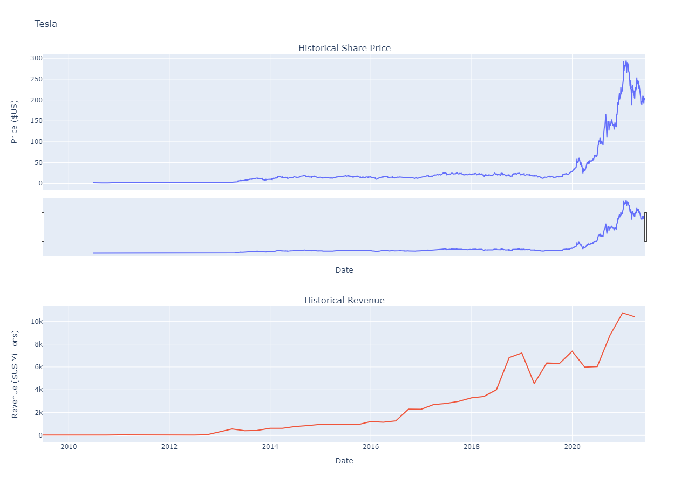
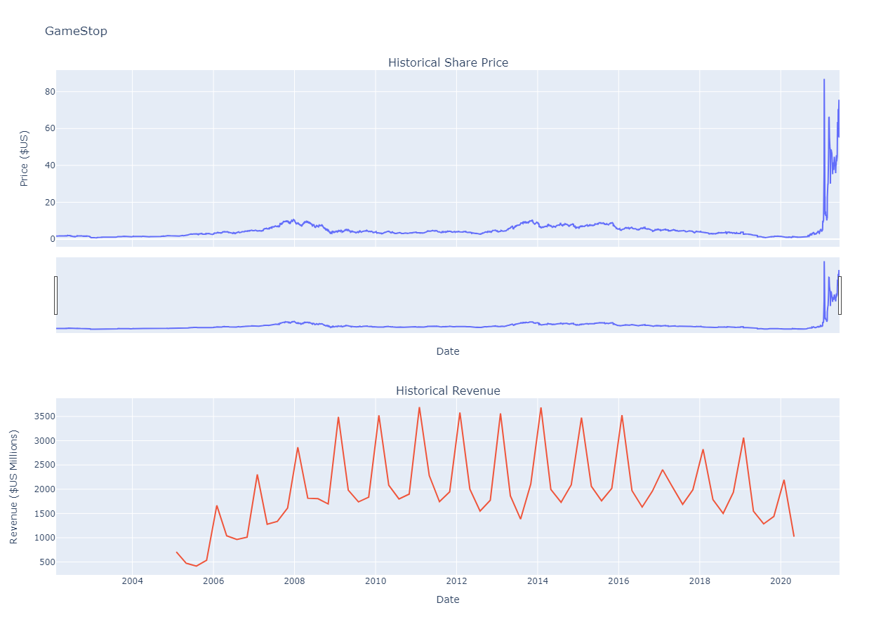

# Tesla & GameStop: Stock Price vs. Revenue Analysis

Data extraction and visualisation project comparing the historical share prices of **Tesla (TSLA)** and **GameStop (GME)** with their quarterly revenue. Share prices were pulled with the `yfinance` API, quarterly revenue was web-scraped from HTML tables with BeautifulSoup, and the two were combined into interactive Plotly dashboards.

> Completed as the final assignment of the **Python Project for Data Science** course (IBM Data Science Professional Certificate, Coursera).


---

## What was done

1. **Stock data:** downloaded the full daily price history for TSLA and GME with `yfinance` and loaded it into pandas.
2. **Revenue data:** scraped quarterly revenue tables with `requests` and BeautifulSoup, then cleaned them (removed `$` and `,` signs, dropped empty rows, converted dates and numbers).
3. **Visualisation:** built a two-panel Plotly chart per company, with share price (including a range slider) above and quarterly revenue below on a shared date axis.

## Results

### Tesla



Tesla's quarterly revenue grows steadily from 2013 and accelerates after 2018. The share price stays flat for years, then rises sharply from 2020, moving far faster than revenue.

### GameStop



GameStop's revenue is strongly seasonal, with a peak every holiday quarter, and trends downward after 2016. The early-2021 price spike is not matched by any change in revenue, which illustrates how far the share price had detached from fundamentals.

## Project structure

```
tesla-gamestop-stock-analysis/
├── images/
│   ├── charts/                  # Final Plotly dashboards
│   └── notebook-screenshots/    # Data extraction steps (stock and revenue tables)
└── README.md
```

## Skills demonstrated

API data extraction (`yfinance`) · Web scraping (requests, BeautifulSoup) · Data cleaning with pandas · Time-series visualisation with Plotly

## Author

**Sathwik Pannati** · M.Eng. Applied AI for Digital Production Management, Technische Hochschule Deggendorf
[LinkedIn](https://www.linkedin.com/in/sathwik-pannati-803a03254/) · [GitHub](https://github.com/sathwikpannati)
